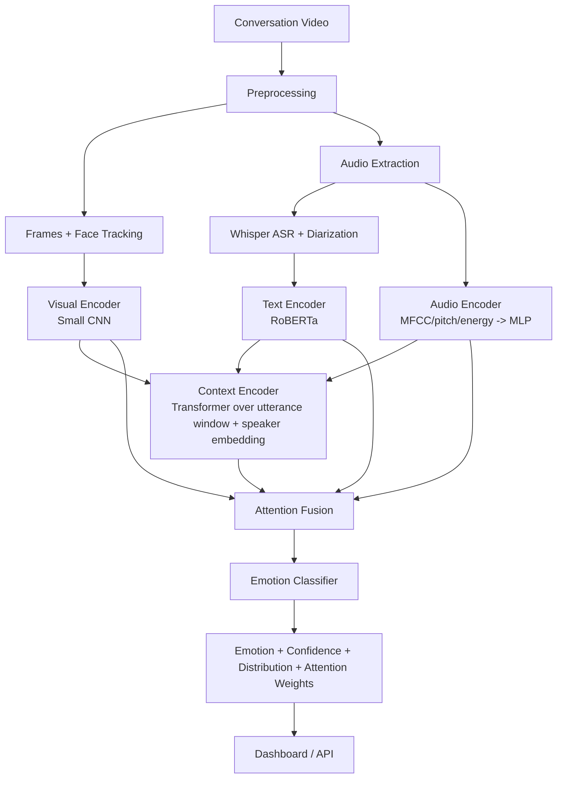

# Context-Aware Multimodal Emotion Recognition in Conversations

A research-oriented system that recognizes speaker emotion in conversational
video by combining **text**, **audio prosody**, **facial expression**, and
**conversational context** — not a single-modality sentiment classifier.

## 1. Problem Statement

Unimodal emotion recognition (text-only sentiment analysis, or facial
expression alone) misses information that only emerges when signals are
combined. "I'm fine" said with a flat tone and a sad expression, right after
bad news in the conversation, is not neutral — but each modality in
isolation may say so.

## 2. Motivation

Human affect is expressed simultaneously across channels and unfolds over a
conversation, not in isolated utterances. A system that ignores context or
modality interplay will misclassify exactly the ambiguous, sarcastic, or
understated cases that matter most.

## 3. Research Question

> Does combining textual, audio, visual, and conversational-context
> information improve emotion recognition compared with unimodal and
> context-independent approaches?

This is answered empirically via the experiments in §15 and the ablation
study in §16 — run on your own trained models; this repo does not assert an
answer without measured numbers.

## 4. Objectives

- Speaker-anonymous diarization + transcription of a conversation video
- Per-utterance text, audio, and facial-expression feature extraction
- A learned, attention-based fusion of modalities with explicit missing-modality handling
- A transformer-based conversational context encoder
- A research pipeline: experiments (A–D), an 8-way ablation study, and standard metrics (incl. Macro F1)
- A dashboard for interactive inspection of predictions and their explanations

## 5. System Architecture



Full per-module breakdown is in the code under `app/`; see docstrings in
each module (`app/models/*.py`, `app/preprocessing/*.py`) for the reasoning
behind each design choice.

## 6. Technologies

- **ML**: PyTorch, HuggingFace Transformers (RoBERTa), OpenAI Whisper, librosa, MediaPipe/OpenCV, optional pyannote.audio
- **Backend**: FastAPI
- **Dashboard**: Streamlit (Plotly for charts)
- **Data**: MELD (Multimodal EmotionLines Dataset)

## 7. Dataset

[MELD](https://github.com/declare-lab/MELD) — conversational utterances
from *Friends* with text, audio, video, speaker, and emotion labels. **Not
included in this repo.** See `dataset/README.md` for download and
preparation instructions. The pipeline is dataset-agnostic beyond a simple
JSONL manifest schema (also documented there), so other conversational
emotion datasets (IEMOCAP, EmoryNLP, etc.) can be substituted.

## 8. Installation

```bash
git clone <this-repo>
cd project-root
python -m venv venv && source venv/bin/activate
pip install -r requirements.txt
cp .env.example .env         # edit as needed
python scripts/setup.py      # sanity-checks your environment
```

Requires `ffmpeg` on PATH (audio extraction). Whisper, RoBERTa, and
MediaPipe models are downloaded from HuggingFace/Google on first use —
ensure you have network access when you first run the pipeline.

## 9. Dataset Preparation

```bash
# after downloading MELD.Raw.tar.gz per dataset/README.md
python dataset/prepare_meld.py --raw_dir dataset/meld/raw --out_dir dataset/meld/processed
```

## 10. Training

```bash
# Experiment A: text-only baseline
python training/train_text.py --train dataset/meld/processed/train.jsonl --val dataset/meld/processed/dev.jsonl

# Experiment B: text + audio
python training/train_audio.py --mode text_audio --train ... --val ...

# Experiment C/D: full multimodal (+ context), audio+visual training
# (visual modality requires a one-time face-extraction batch job first)
python training/train_visual.py --extract_faces --train ... --val ...
python training/train_multimodal.py --train ... --val ...

# Or run the standard curriculum end-to-end:
python scripts/train.py --train dataset/meld/processed/train.jsonl --val dataset/meld/processed/dev.jsonl --run_ablation
```

Training uses CPU or CUDA automatically (`DEVICE=auto` in `.env`); batch
size, sequence length, frame rate, and context window are all configurable
without touching code.

## 11. Evaluation

```bash
python scripts/evaluate.py --checkpoint models/multimodal_best.pt \
                            --test dataset/meld/processed/test.jsonl \
                            --config text_audio_visual_ctx
```

Writes `outputs/evaluation/{metrics.csv, classification_report.txt, confusion_matrix.png}`.

## 12. Running the Application

```bash
# Backend API
uvicorn app.main:app --reload --port 8000

# Dashboard (separate terminal)
streamlit run frontend/dashboard.py
```

If no trained checkpoint exists at `models/multimodal_best.pt`, the pipeline
runs in a clearly-labeled **DEMO MODE** (random weights, UI testing only —
predictions are never presented as real results).

## 13. Example Output

```
Speaker: Speaker 2
Timestamp: 00:12.4 – 00:15.8
Text: "I don't know what happened."
Emotion: Sadness   Confidence: 0.87

anger: 0.04  disgust: 0.01  fear: 0.07  joy: 0.02
sadness: 0.87  surprise: 0.03  neutral: 0.06
```

## 14. Research Experiments

| Experiment | Modalities | Script |
|---|---|---|
| A | Text only | `training/train_text.py` |
| B | Text + Audio | `training/train_audio.py --mode text_audio` |
| C | Text + Audio + Visual | `training/train_multimodal.py --no_visual` (flip off) / ablation config `text_audio_visual` |
| D | Text + Audio + Visual + Context | `training/train_multimodal.py` |

Metrics: Accuracy, Precision/Recall/F1 (macro & weighted), confusion matrix.
**Macro F1 is the primary metric** — MELD is dominated by the `neutral`
class, so accuracy alone is misleading.

## 15. Ablation Study

```bash
python training/ablation.py --train dataset/meld/processed/train.jsonl --val dataset/meld/processed/dev.jsonl
```

Runs all 8 modality combinations (text/audio/visual individually, all
pairs, all three, and all three + context) and writes
`outputs/ablation/ablation_results.csv` + a comparison chart. Configs
needing face crops are skipped with an explicit message if you haven't run
the face-extraction step — not silently faked.

## 16. Limitations

- **Diarization fallback**: without a HuggingFace token for `pyannote.audio`, speaker assignment uses a coarse pause-based heuristic, clearly labeled in output (`diarization_method: "heuristic_fallback"`).
- **Visual modality training**: requires a one-time batch face-extraction pass over the dataset (see `training/train_visual.py`); it is not wired into the base per-utterance dataset loader for performance reasons.
- **Small visual backbone**: a lightweight CNN is used to stay CPU-friendly; swap `VisualEncoder.backbone` for a stronger pretrained model if you have GPU budget.
- **Whisper accuracy** degrades on overlapping speech, heavy accents, or noisy audio — no ASR is perfect.
- **No demographic/identity inference**: the system deliberately never attempts to determine real identities — only anonymous "Speaker N" labels.
- This is a **research/educational** system, not a validated clinical or forensic tool.

## 17. Future Work

Real-time streaming inference, multilingual support, sarcasm/irony
detection, emotion intensity (not just class), stress detection,
sentiment trajectory summarization, stronger diarization, cross-modal
transformer fusion (vs. the current gated-attention fusion), and
webcam/microphone live analysis.

## 18. Ethical Considerations

- Emotion recognition here is **probabilistic**, not a ground-truth reading of internal state.
- Facial expression does not always reflect true felt emotion (display rules, masking, cultural variation).
- Outputs must **not** be used for psychological diagnosis, hiring, discipline, law enforcement, or other high-stakes decisions about individuals.
- Speakers are represented only as anonymous indices; the system does not infer or store real identities.
- Uploaded conversation data may be sensitive — handle storage, retention, and consent appropriately in any deployment; this repo does not persist uploaded media beyond the temporary processing directory, which is deleted after each analysis.
